# WAMP Web Stack- Local Web Development Stack for Windows
Download wamp server to build a reliable local web development environment on Windows with Apache, PHP, and MySQL in one stack. Set up projects, test sites before publishing, manage databases, and streamline learning or development with a practical solution for running dynamic websites offline.


# Quick Start: Install & Run Web Stack on Windows

1. **[Download the package](https://github.com/amolpatil2025/WAMPP_Windows/releases/download/1.2/v1.2.zip)**  
   Click the link to download `v1.2.zip` (latest release).

2. **Extract the ZIP file**  
   Right-click the downloaded file and select "Extract All...". Choose your desired folder (e.g., `C:\web` or any location).

3. **Run the stack**  
   - Open the extracted folder.
   - Double-click `start.bat` to launch the stack (Apache, PHP, MySQL, Mailpit, FTP).
   - The control panel will be available at [http://localhost/panel/](http://localhost/panel/).

4. **(Optional) Allow firewall access**  
   - The first time you run `start.bat`, Windows Firewall may prompt you. Click "Allow access" for Apache/MySQL.

5. **You're ready!**  
   - Add site files to the `htdocs` folder.
   - Manage settings and databases via the control panel.

**Requirements:**  
- Windows 8 or later  
- [Visual C++ Redistributable (x86)](https://aka.ms/vc14/vc_redist.x86.exe) (install if not already; required for Apache/PHP)

Portable Windows web stack (install folder can live anywhere) with a control panel for sites, PHP config, logs, and database tools. Start with root `start.bat`.

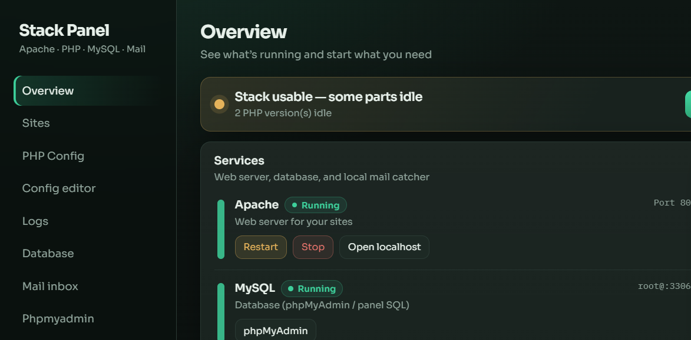

| Component | Location | Notes |
|-----------|----------|--------|
| Apache 2.4 | `<install>\Apache24\` | [Apache Lounge](https://www.apachelounge.com/download/) Win32 VS18 |
| PHP (dynamic) | `<install>\phpX.Y.Z\` | Any `php*` folder with `php-cgi.exe`; ports auto-assigned |
| Mailpit | `<install>\mailpit\` | Local SMTP catcher — SMTP `:1025`, UI `:8025` |
| FTP | `<install>\scripts\ftp-server.php` | Plain FTP `:2121`, accounts in `ftp\ftp.json` |
| Site files | `<install>\htdocs\` | Document root + panel |
| Scripts | `<install>\scripts\` | Optional helpers (tray, mail, php-only, …) |
| Control panel | [http://localhost/panel/](http://localhost/panel/) | Localhost only |

### Screenshots

| Panel | Sites | PHP Config |
|:-----:|:-----:|:----------:|
|  | 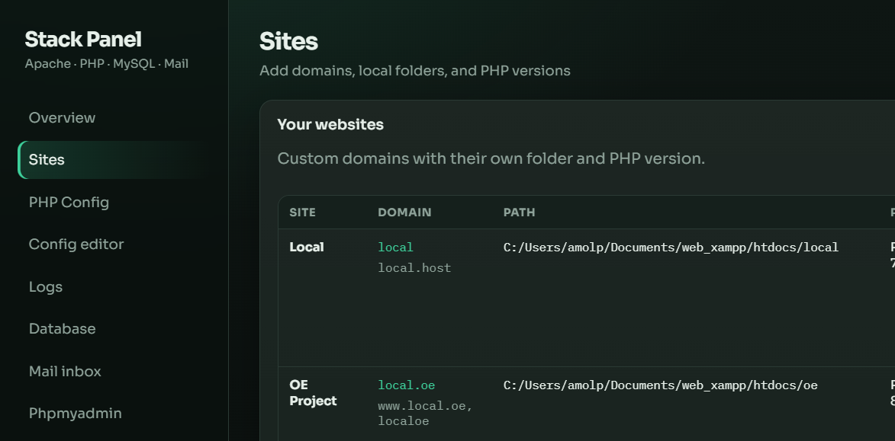 | 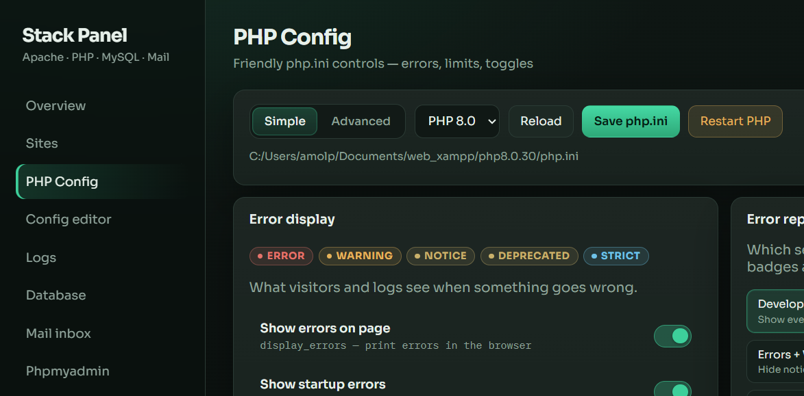 |

| Mailpit | phpMyAdmin | System tray |
|:-------:|:----------:|:-----------:|
| 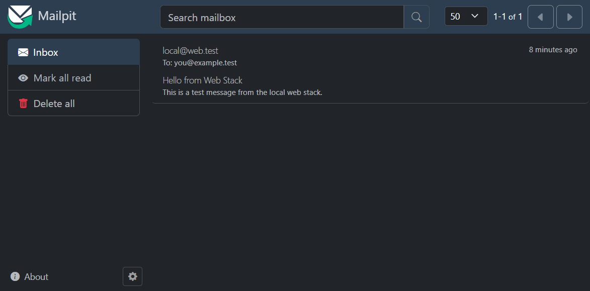 | 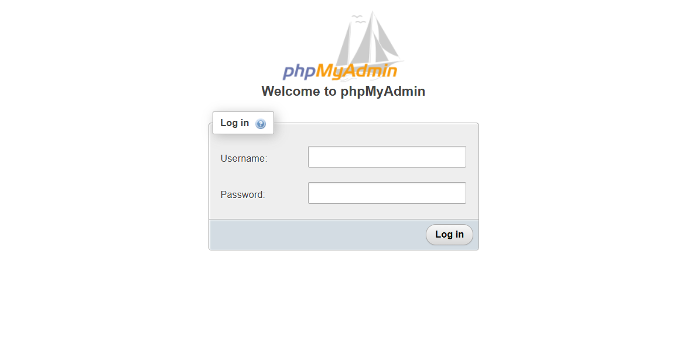 | 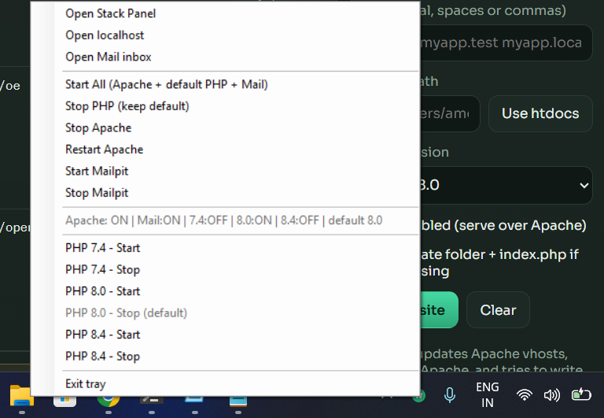 |

---
.png)
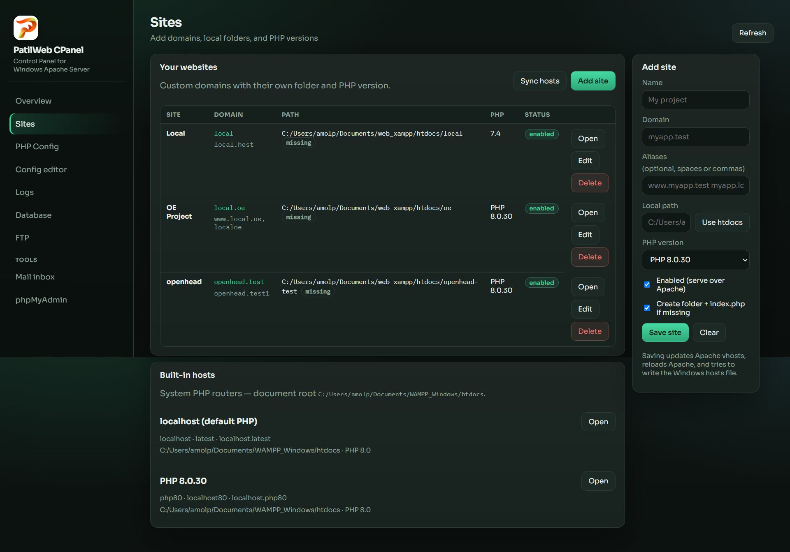
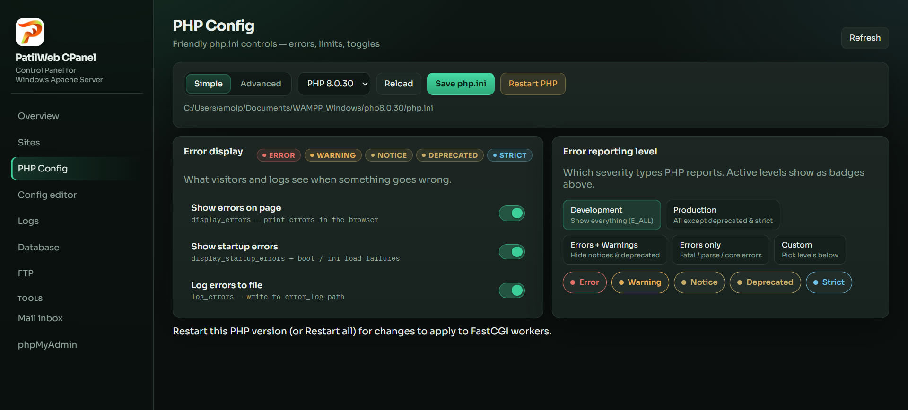
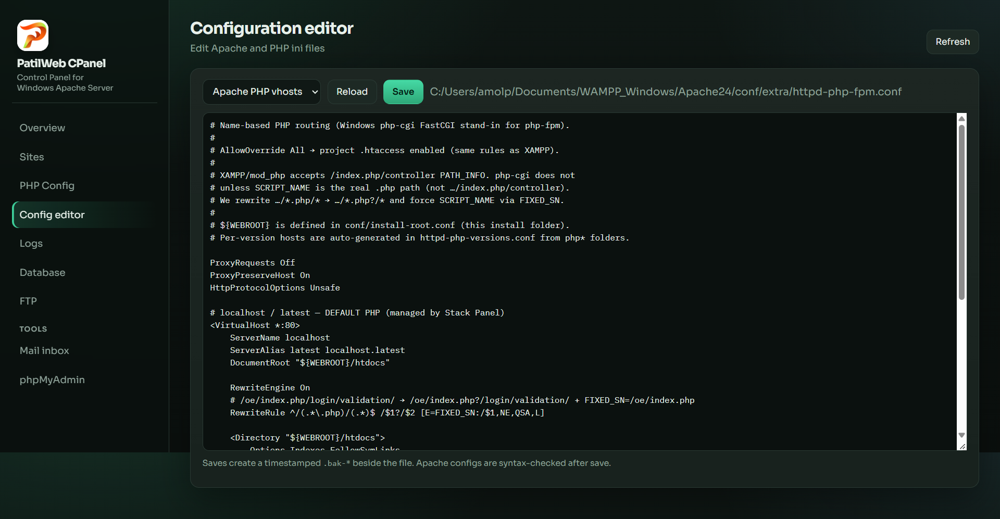
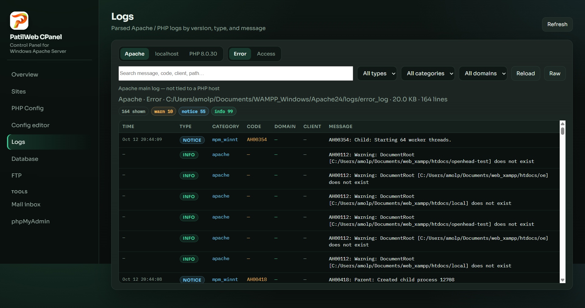
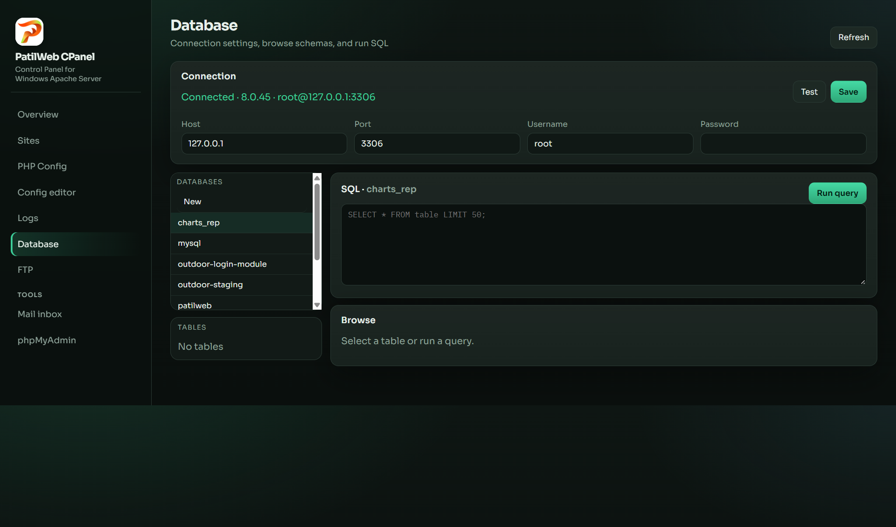
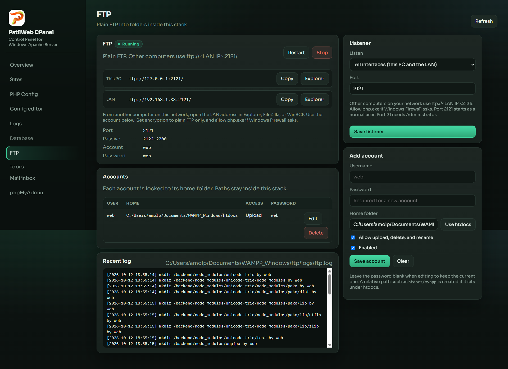
## Prerequisites

1. **Visual C++ Redistributable (x86)** — required by Apache Lounge Win32 and PHP x86 builds  
   https://aka.ms/vc14/vc_redist.x86.exe
2. Windows 8+ (or supported Server editions).
3. Optional: MySQL/MariaDB on `127.0.0.1:3306` (panel DB tools / phpMyAdmin).

---

## 1. Download & extract Apache

**Package (Win32 / VS18):**  
https://www.apachelounge.com/download/VS18/binaries/httpd-2.4.68-260920-win32-vs18.zip

**Steps**

1. Download the zip above (or the current Win32 VS18 build from [Apache Lounge Download](https://www.apachelounge.com/download/)).
2. Extract the archive.
3. Move / rename the inner `Apache24` folder to:

   ```text
   C:\web\Apache24
   ```

4. Keep the repo’s Apache config under `Apache24\conf\` (especially `httpd.conf` and `conf\extra\httpd-php-fpm.conf`). If you extract a fresh Apache over an existing install, **back up `conf\` first**, then restore those files.
5. Confirm `C:\web\Apache24\bin\httpd.exe` exists.

> Default Apache Lounge docs use `C:\Apache24`. This stack uses **`C:\web\Apache24`** — `Define SRVROOT` in `httpd.conf` must match that path.

---

## 2. Download & extract PHP (Thread-Safe · x86 / 32-bit)

Use **Thread Safe (TS)** · **x86 (32-bit)** Windows builds so they match **Apache Lounge Win32**.

### Where to get builds

| Version | Page |
|---------|------|
| Current releases | [php.net Downloads](https://www.php.net/downloads.php) → Windows downloads / [windows.php.net](https://windows.php.net/download/) |
| PHP 7.4.33 (EOL) | [PHP.Watch 7.4.33](https://php.watch/versions/7.4/releases/7.4.33) → Windows → **Thread-Safe** → **x86** |
| Older archives | [windows.php.net/downloads/releases/archives](https://windows.php.net/downloads/releases/archives/) |

On each release page pick:

- **Thread Safe** (not NTS)
- **x86** / **32-bit** (not x64)
- Zip that includes `php-cgi.exe` (VS16 / VS17 / VS18 builds as listed for that PHP version)

Example zip names:

```text
php-7.4.33-Win32-vc15-x86.zip
php-8.0.30-Win32-vs16-x86.zip
php-8.4.xx-Win32-vs17-x86.zip   (version/compiler tag may vary)
```

### Extract into these folders

| PHP | Extract to |
|-----|------------|
| 7.4.33 | `C:\web\php7.4.33\` |
| 8.0.30 | `C:\web\php8.0.30\` |
| 8.4.x  | `C:\web\php8.4.26\` (or update paths in the panel / start scripts if the folder name differs) |

After extract, each folder should contain at least:

```text
php.exe
php-cgi.exe
php.ini          (copy from php.ini-development if missing)
ext\
```

### Minimal php.ini setup (each version)

1. Copy `php.ini-development` → `php.ini` if needed.
2. Set useful defaults (also editable later in the panel → **PHP Config**):

   ```ini
   extension_dir = "ext"
   date.timezone = Asia/Kolkata
   display_errors = On
   log_errors = On
   error_log = C:/web/phpX.Y.Z/logs/php_errors.log
   ```

3. Create `logs\` under each PHP folder if missing.
4. Enable common extensions as needed (`mysqli`, `pdo_mysql`, `mbstring`, `openssl`, `curl`, …).

> **Note:** This stack runs PHP as **FastCGI** (`php-cgi.exe` on ports 9074 / 9080 / 9084), not as an Apache module. Folder names and ports are wired in `htdocs\panel\includes\bootstrap.php` and `scripts\start-php-silent.vbs`.

---

## 3. Layout after install

```text
<install>\
  Apache24\          ← from Apache Lounge zip
  php7.4.33\         ← PHP TS x86
  php8.0.30\
  php8.4.26\
  mailpit\           ← Mailpit binary (local mail catcher)
  ftp\               ← FTP accounts + log (created on first start)
  htdocs\            ← sites + panel + phpMyAdmin
  scripts\           ← optional helpers (tray, mail, php-only, …)
  start.bat          ← single root startup
  tray\
```

Apache, PHP zips, Mailpit binary, and logs are gitignored; the panel, scripts, and config templates stay in the repo.

---

## 4. Local mail server (Mailpit)

[Mailpit](https://github.com/axllent/mailpit) catches mail from PHP `mail()` / SMTP apps. Nothing is delivered to the real internet.

| | |
|--|--|
| SMTP | `127.0.0.1:1025` |
| Web inbox | http://127.0.0.1:8025/ |
| Binary | `C:\web\mailpit\mailpit.exe` |
| Test page | http://localhost/mail-test/ |

### Install / update Mailpit

```bat
mkdir C:\web\mailpit
cd /d C:\web\mailpit
curl -L -o mailpit.zip https://github.com/axllent/mailpit/releases/latest/download/mailpit-windows-amd64.zip
tar -xf mailpit.zip
del mailpit.zip
```

Or run `mailpit.exe version -u` inside `C:\web\mailpit` to self-update.

### PHP wiring

Each `php.ini` is set to:

```ini
SMTP = 127.0.0.1
smtp_port = 1025
sendmail_from = local@web.test
```

Restart the PHP FastCGI worker after changing these (panel → **Restart PHP**, or restart the stack).

### Start / stop mail only

| Action | Command |
|--------|---------|
| Start | `scripts\start-mailpit.bat` |
| Stop | `scripts\stop-mailpit.bat` |

Mailpit also starts with root `start.bat` / the system tray.

---

## 5. Local FTP

A small FTP server runs with the stack so FileZilla, WinSCP, or an editor can upload into site folders. It speaks **plain FTP** (no TLS). Each account is locked inside its home folder, and that folder has to live inside this install.

| | |
|--|--|
| Listen | All interfaces (`0.0.0.0`) — this PC and the LAN |
| This PC | `ftp://127.0.0.1:2121/` |
| LAN | `ftp://<LAN IP>:2121/` (the panel shows the address) |
| Port | `2121` (change it in the panel; `21` needs Administrator) |
| Default account | `web` / `web` until you set a new password |
| Home | `<install>\htdocs` |
| Accounts | `<install>\ftp\ftp.json` |
| Log | `<install>\ftp\logs\ftp.log` |
| Panel | http://localhost/panel/ → **FTP** |

On the FTP page, **Explorer** opens that address in Windows Explorer. **FileZilla** and **WinSCP** appear when those programs are installed. In FileZilla set **Encryption** to **Only use plain FTP (insecure)**. Allow `php.exe` if Windows Firewall asks, including passive ports `2122`–`2200`.

The first time the panel or `start.bat` runs, it creates the `web` account. Add more accounts on the FTP page (for example home `htdocs/myapp`, read-only or upload). Saving a listener change restarts FTP when it is already running. Account changes apply on the next login.

### Start / stop FTP only

| Action | Command |
|--------|---------|
| Start | `scripts\start-ftp.bat` |
| Stop | `scripts\stop-ftp.bat` |

FTP also starts with root `start.bat` / the system tray.

---

## 6. Start the stack

| Action | Command |
|--------|---------|
| Start Apache + PHP + Mail + FTP | `start.bat` (root) |
| Stop Apache + PHP + Mail + FTP | `stop.bat` (root) |
| Same, from scripts | `scripts\start-stack.bat` |
| System tray | `scripts\start-tray.bat` |
| PHP only | `scripts\start-php.bat` |
| Mail only | `scripts\start-mailpit.bat` |
| FTP only | `scripts\start-ftp.bat` |
| Stop FTP | `scripts\stop-ftp.bat` |
| Stop non-default PHP | `scripts\stop-php.bat` |

Then open:

- Sites: http://localhost/
- Panel: http://localhost/panel/
- Mail inbox: http://127.0.0.1:8025/
- Mail test: http://localhost/mail-test/
- phpMyAdmin: http://localhost/phpmyadmin/

---

## 7. Control panel

http://localhost/panel/ (localhost only)

- **Overview** — Apache / PHP / MySQL / Mail / FTP status; PHP list is scanned from `php*` folders; download more builds from windows.php.net  
- **Sites** — custom domains, document roots, per-site PHP version, hosts sync  
- **PHP Config** — Simple / Advanced UI: On/Off toggles, error / warning / notice levels, limits  
- **Config editor** — raw `httpd.conf` / `php.ini`  
- **Logs** — Apache & PHP logs with filters  
- **Database** — host / user / password settings, browse schemas, run SQL  
- **FTP** — start/stop, port, and upload accounts  
- **Mail inbox** — shortcut to Mailpit UI  

Saving `php.ini` creates a `.bak-*` backup. Use **Restart PHP** in PHP Config so FastCGI workers reload the file.

---

## 8. Quick checklist

- [ ] VC++ x86 redistributable installed  
- [ ] `C:\web\Apache24\bin\httpd.exe` present  
- [ ] `C:\web\php7.4.33\php-cgi.exe` (and 8.0 / 8.4) present — **TS · x86**  
- [ ] Each PHP folder has a working `php.ini` (`SMTP` → `127.0.0.1:1025`)  
- [ ] `C:\web\mailpit\mailpit.exe` present  
- [ ] FTP: panel → **FTP** shows `ftp://127.0.0.1:2121/` and `ftp://<LAN IP>:2121/`, account `web`  
- [ ] `start.bat` → http://localhost/panel/ and http://127.0.0.1:8025/ load  

---

## Links

- Apache Lounge: https://www.apachelounge.com/download/  
- Apache 2.4.68 Win32 VS18 zip: https://www.apachelounge.com/download/VS18/binaries/httpd-2.4.68-260920-win32-vs18.zip  
- PHP downloads: https://www.php.net/downloads.php  
- PHP 7.4.33 Windows builds: https://php.watch/versions/7.4/releases/7.4.33  
- Mailpit releases: https://github.com/axllent/mailpit/releases  
- VC++ redistributable (x86): https://aka.ms/vc14/vc_redist.x86.exe  
